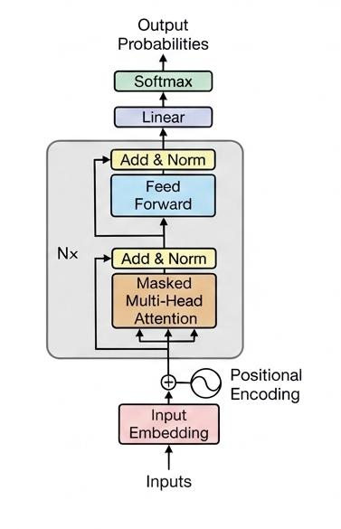

# Mini GPT: A Decoder-Only Transformer From Scratch with PyTorch

This project aims to demonstrate the core concepts behind GPT-style language models, including tokenization, embeddings, causal self-attention, transformer blocks, training, validation, and autoregressive text generation.

## Features

- Custom Word-Level Tokenizer implemented from scratch.
- Token and positional embeddings.
- Causal Multi-Head Self-Attention.
- Pre-Layer Normalization Transformer Blocks.
- Feed-Forward Neural Networks with GELU activation.
- Residual connections and dropout.
- Next-token prediction using Cross-Entropy Loss.
- Training with AdamW optimizer.
- Gradient clipping.
- Training and validation loss monitoring.
- Autoregressive text generation.

## Decoder-Only Transformer architecture:

# Project Phases & Implementation

## Phase 1: Dataset Preparation

The first phase focused on preparing the text data used to train and evaluate the model.

A small dataset containing 20 English sentences was created. The dataset was divided into two separate sets:
- **Training Set:** 16 sentences used to train the model.
- **Validation Set:** 4 sentences used to evaluate the model during training.

The split was performed at the sentence level to keep the training and validation data separate.

## Phase 2: Custom Word-Level Tokenizer

In this phase, a custom Word-Level Tokenizer was implemented to convert raw text into numerical representations that the model can process.

The tokenizer performs the following tasks:
- Splits sentences into individual words and punctuation marks.
- Builds a vocabulary from the training sentences.
- Assigns a unique integer ID to each token.
- Converts text into sequences of token IDs.
- Converts token IDs back into readable text.
- Handles unknown words using the `<unk>` token.
- Uses the `<eos>` token to indicate the end of a sentence.

The vocabulary is built using only the training data to avoid information leakage from the validation set.

## Phase 3: Data Encoding and Batching

After tokenization, the sentences are converted into sequences of numerical token IDs.

In this phase, a batching mechanism was implemented to prepare the data for model training.

For each selected sentence:
- The input sequence contains the tokens except the last one.
- The target sequence contains the same tokens shifted one position to the left.

This allows the model to learn next-token prediction.

Since sentences have different lengths, padding is used to make sequences within a batch have compatible dimensions. Padding positions in the target sequences are ignored when calculating the loss.

## Phase 4: Token and Positional Embeddings

Transformers operate on numerical vectors rather than raw token IDs. This phase introduces the embedding layer that converts token IDs into dense vector representations.

Two types of embeddings were implemented:

- **Token Embeddings:** Represent the meaning of each token as a learnable vector.
- **Positional Embeddings:** Represent the position of each token within the input sequence.

The two embeddings are added together to provide the model with both token and positional information.

## Phase 5: Causal Multi-Head Self-Attention

This phase implements the attention mechanism, which allows each token to use information from previous tokens when processing a sequence.

The implementation includes:
- Query, Key, and Value projections.
- Splitting the representations into multiple attention heads.
- Scaled dot-product attention to calculate attention scores.
- A causal mask that prevents each token from accessing future tokens.
- Combining the attention heads and applying an output projection.

The causal masking is essential for autoregressive language modeling because the model must predict the next token without seeing future tokens.

## Phase 6: Feed-Forward Network

The Feed-Forward Network processes the representations produced by the attention mechanism.

It consists of:
- A first linear layer that expands the embedding dimension.
- GELU activation to introduce non-linearity.
- A second linear layer that projects the representation back to its original dimension.
- Dropout to help reduce overfitting.

This network is applied independently to each token position.

## Phase 7: Transformer Decoder Block

In this phase, the attention mechanism and Feed-Forward Network are combined into a single Transformer Decoder Block.

The block uses:
- Layer Normalization before each main sublayer (Pre-LN).
- Causal Multi-Head Self-Attention.
- A Feed-Forward Network.
- Residual connections around both sublayers.

Residual connections help preserve information and support the training of deeper neural networks.

## Phase 8: Decoder Architecture

The complete Decoder-Only Transformer architecture is built by combining the previously implemented components.

The model consists of:
1. Token and positional embeddings.
2. Multiple Transformer Decoder Blocks.
3. A final Layer Normalization layer.
4. A language modeling head that maps the hidden representations to vocabulary logits.

The output represents the predicted scores for every vocabulary token at each position in the input sequence.

## Phase 9: Model Training

In this phase, the model is trained to predict the next token in a sequence.

The training process includes:
- Creating batches from the training sentences.
- Passing input sequences through the model.
- Comparing predicted logits with the target token IDs.
- Calculating Cross-Entropy Loss.
- Updating model parameters using the AdamW optimizer.
- Applying gradient clipping to limit excessively large gradients.

Training and validation losses are periodically estimated to monitor the model's learning progress.

## Phase 10: Validation and Evaluation

The validation phase monitors how well the model performs on sentences that were not used during training.

Validation loss is calculated to compare the model's predictions against the expected next tokens.

## Phase 11: Autoregressive Text Generation

The final phase implements text generation using the trained Decoder-Only Transformer.

The generation process works one token at a time:
1. The model receives an initial context.
2. It predicts logits for the next token.
3. Temperature scaling adjusts the probability distribution.
4. Optional Top-K sampling limits the candidate tokens.
5. The next token is sampled from the resulting probability distribution.
6. The generated token is added to the context, and the process repeats.

The context is limited to the model's maximum sequence length (`block_size`).

This demonstrates the basic autoregressive generation process used by GPT-style language models.

## Model Configuration

| Parameter | Value |
|---|---:|
| Embedding Dimension | 32 |
| Attention Heads | 4 |
| Transformer Layers | 2 |
| Feed-Forward Dimension | 128 |
| Context Length | 8 |
| Dropout | 0.1 |
| Batch Size | 4 |
| Training Steps | 150 |
| Learning Rate | 0.001 |
| Optimizer | AdamW |
| Device | CPU |
